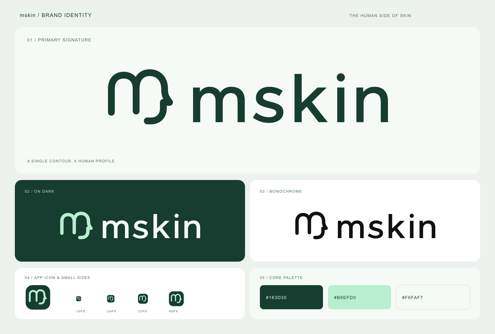

# هویت بصری mskin

نشان از یک «m» نرم و نامتقارن ساخته شده است. قوس دوم به پیشانی، بینی و خط فک ادامه پیدا می‌کند. نوشتهٔ `mskin` نیز مسیر برداری مستقل دارد و برای نمایش یا چاپ به فونت نصب‌شده وابسته نیست.



## رنگ و کاربرد

| کاربرد | نشان | نوشته | زمینه |
| --- | --- | --- | --- |
| هدر، ورود و فوتر | `#163D30` | `#163D30` | سفید یا روشن |
| پنل تیره | `#B8EFD0` | `#F6FAF7` | سبز عمیق یا تیره |
| چاپ تک‌رنگ | `#111111` | `#111111` | سفید |
| چاپ معکوس | `#FFFFFF` | `#FFFFFF` | مشکی یا تیره |

کنتراست رنگ اصلی روی سفید ۱۲٫۰۴ به ۱ و نعنایی روی سبز آیکون ۹٫۳۴ به ۱ است. این مقادیر برای همین جفت‌رنگ‌ها محاسبه شده‌اند. رنگ‌های رابط و زمینهٔ پنل در [راهنمای رنگ‌ها](colors.md) آمده‌اند. نسخهٔ نعنایی را روی سفید استفاده نکنید. روی عکس یا زمینهٔ شلوغ، لوگو را در یک سطح سادهٔ روشن یا تیره قرار دهید.

لوگوی اصلی بدون کادر است. کادر سبز فقط در آیکون مرورگر و اپ استفاده می‌شود. شکل را نکشید، وارونه نکنید و به آن سایه، گرادیان یا جزئیات تزئینی اضافه نکنید. جهت لوگو در رابط فارسی هم چپ به راست می‌ماند.

حداقل ارتفاع پیشنهادی برای لوگوی کامل ۳۲ پیکسل و برای نشان مستقل ۲۴ پیکسل است. اطراف لوگو دست‌کم یک‌چهارم ارتفاعش فضای خالی در نظر بگیرید. برای اندازه‌های ۱۶ و ۳۲ پیکسل مرورگر، از favicon آماده با ضخامت بیشتر استفاده کنید.

## فایل‌ها

نسخه‌های SVG لوگو و نشان پس‌زمینهٔ شفاف دارند و حروفشان مسیر برداری است.

- `public/mskin-logo.svg` — لوگوی افقی روی زمینهٔ روشن
- `public/brand/mskin-logo-light.svg` — لوگوی افقی روی زمینهٔ تیره
- `public/brand/mskin-logo-black.svg` و `mskin-logo-white.svg` — نسخه‌های تک‌رنگ
- `public/brand/mskin-mark-dark.svg` و `mskin-mark-light.svg` — نشان مستقل
- `public/brand/mskin-stacked-dark.svg` و `mskin-stacked-light.svg` — ترکیب عمودی برای جای باریک
- `public/brand/mskin-preview.png` — پیش‌نمایش رنگ‌ها و کاربردها
- `public/favicon.svg` و `favicon-32.png` — آیکون مرورگر
- `public/icon-192.png` و `icon-512.png` — آیکون اپ
- `public/maskable.png` — آیکون با زمینهٔ کامل و نشان داخل محدودهٔ امن برش
- `public/apple-icon.png` — آیکون اپل با زمینهٔ کامل

## استفاده در کد

```tsx
<MskinLogo height={36} />
<MskinLogo height={76} variant="stacked" tone="light" />
<MskinLogo height={44} variant="mark" decorative />
```

حالت پیش‌فرض `tone="auto"` است و نسخهٔ لوگو با حالت روشن یا تیرهٔ سایت عوض می‌شود. برای سطحی با رنگ ثابت، `tone="dark"` روی زمینهٔ روشن و `tone="light"` روی زمینهٔ تیره استفاده می‌شود. وقتی نام برند از متن کناری یا نام دسترس‌پذیر لینک خوانده می‌شود، `decorative` از تکرار نام برای صفحه‌خوان جلوگیری می‌کند.

منبع تمام هندسه‌ها و خروجی‌ها `scripts/generate-brand.mjs` است. برای تغییر لوگو، این منبع را ویرایش و خروجی‌ها را دوباره تولید کنید.

```sh
node scripts/generate-brand.mjs
```

فایل‌های عمومی تولیدشده همراه تغییر منبع در گیت نگهداری می‌شوند. در صورت تغییر آیکون‌های کش‌شده، نسخهٔ کش در `public/sw.js` را هم افزایش دهید.
